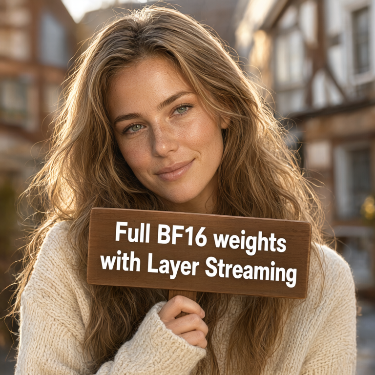

# Qwen Image 2.1 WebGPU

A pure Rust inference engine for [Qwen Image 2.1](https://huggingface.co/Qwen/Qwen-Image-2.1), running entirely in your browser using the Burn framework and WebGPU. As of October 2026, this model holds the Rank 1 spot on the Text-to-Image Arena in the Open Source category.

#### Live: [Hugging Face Space](https://inventwithdean-qwen-image-2-1-webgpu.static.hf.space/)

#### Sample Generations: 


<table>
  <tr>
    <td></td>
    <td></td>
    <td></td>
  </tr>
</table>


## Features

* **Browser-Native Inference:** Runs on any GPU via the `wgpu` backend, featuring full WebGPU support.
* **Low VRAM Footprint:** Implements Disk Layer Streaming to fetch and unload transformer blocks directly from the browser's Origin Private File System (OPFS) on demand.
* **Optimized Compute:** Uses Flash Attention within the Diffusion Transformer (DiT) and Text encoder's Transformer to prevent materializing full N x N matrices, drastically saving memory.
* **Quantization:** Leverages int8 block quantized transformer blocks for high-performance execution.


## Build Instructions

To compile the Rust inference engine into WebAssembly for the browser UI, you will need `wasm-pack`.

1. Install `wasm-pack` via Cargo:

```bash
cargo install wasm-pack
```

2. Compile the package with the `web` target:

```bash
wasm-pack build --target web
```

## Architecture & Integration

The core logic mapping Rust functions to JavaScript is heavily centralized in `lib.rs`. This file defines the `QwenWeb` WebAssembly struct, which orchestrates the entire generation lifecycle:

* **Initialization & Loading:** Asynchronously sets up the WebGPU device and loads the tokenizer, VAE, and neural network shells.


* **Text Encoding:** Formats the user's prompt with system templates and passes it through the `Qwen3VLTextModel` to extract hidden states.


* **Denoising Loop:** Generates latents step-by-step using the `QwenImageTransformerModel` over a specific noise schedule.


* **Image Decoding:** Pushes the denoised latents through the VAE to return a clean `DecodedImage` containing the final RGBA pixel array.


To bypass the browser's strict memory limitations, the engine avoids keeping the entire model in RAM simultaneously. The `worker.js` script utilizes remote procedure calls from `rpc.js` to trigger generation off the main thread. Meanwhile, `streamer.rs` and `store.js` work in tandem to lazily stream the 32 DiT layers and 36 Text Encoder layers directly from the OPFS cache as the forward pass progresses.

## Usage

After building the WebAssembly package, you can run the provided web interface locally:

1. Serve the root directory using a local web server (e.g., `python3 -m http.server 8000` or `npx serve`).
2. Open `qwen-image-2.1.html` in a WebGPU-enabled browser.
3. Use the interface to adjust generation steps (from 2 to 40) and select output dimensions ranging from 256x256 up to 1024x1024 across square, portrait, and landscape aspect ratios.
4. The generated output can be saved directly as a PNG once complete.


## License

The inference code is distributed under the MIT license, while the model weights fall under the Qwen-Research license. Built leveraging the Burn framework, CubeCL, and wgpu.